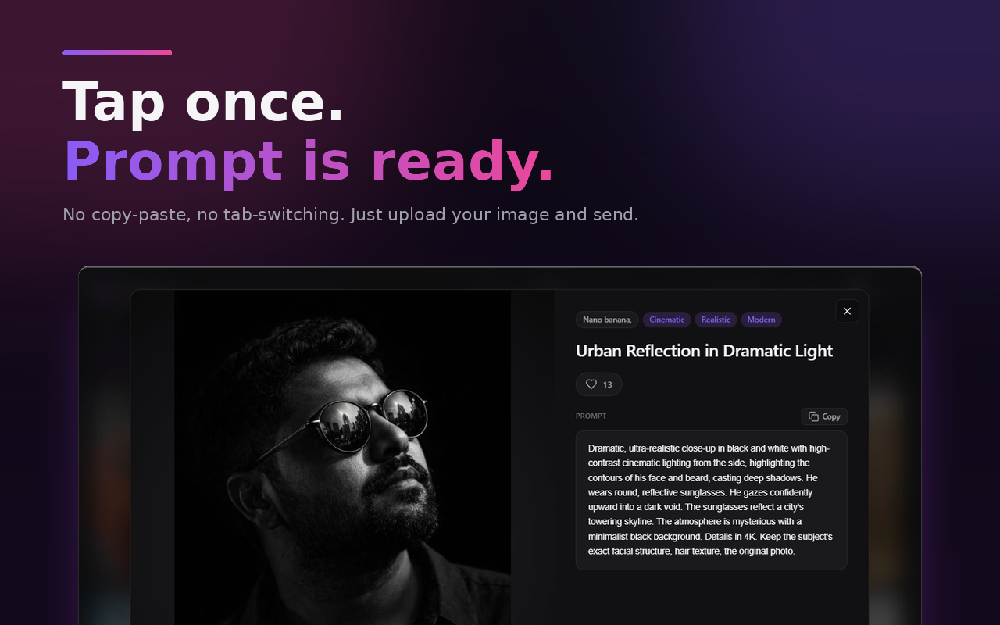

# Prompt Trove: Visual AI Image Prompts Gallery for ChatGPT, Gemini and Sora

Prompt Trove is a free Chrome extension that puts a visual gallery of AI image prompts inside your AI chat. Instead of searching websites for prompt ideas and copy-pasting them, you browse more than 4,000 curated image prompts as picture cards, tap the one you like, and the prompt lands in the chat box.

**[Install from the Chrome Web Store](https://chromewebstore.google.com/detail/jlmekdelomcmjdaaliijobkbgobjacgj?utm_source=github&utm_medium=readme&utm_campaign=prompt_trove)** | **[Full guide and FAQ](https://www.addonschrome.com/extensions/prompt-trove-visual-ai-image-prompts-gallery.html?utm_source=github&utm_medium=readme&utm_campaign=prompt_trove)** | **[Video demo](https://www.youtube.com/watch?v=ZKJBycEO-ls)**

This repository is the public home for Prompt Trove documentation, release notes and the issue tracker. The extension itself is distributed through the Chrome Web Store.

## Features

- 4,000+ curated AI image prompts, shown as a Pinterest-style gallery
- 40+ categories and styles, such as cinematic, editorial, product, 3D render and anime
- One click from browsing to a ready prompt in the composer
- Optional variables you can fill in before the prompt is inserted
- Works on 5 AI platforms, including ChatGPT, Gemini and Claude
- Interface in 54 languages

## How to use it

1. Install Prompt Trove from the [Chrome Web Store](https://chromewebstore.google.com/detail/jlmekdelomcmjdaaliijobkbgobjacgj?utm_source=github&utm_medium=readme&utm_campaign=prompt_trove).
2. Open ChatGPT, Gemini or another supported assistant.
3. Open the gallery and browse by category or style.
4. Tap a card. Fill in the variables if the prompt has any.
5. Upload a reference image if you want one, and send.

The [full guide](https://www.addonschrome.com/extensions/prompt-trove-visual-ai-image-prompts-gallery.html?utm_source=github&utm_medium=readme&utm_campaign=prompt_trove) shows the gallery and the supported platforms.

## Who it is for

- Designers and creatives looking for a visual starting point
- Marketers and content creators who need hero images, social posts or ad visuals
- Students and researchers who need an illustration for a presentation
- Anyone learning how prompt wording changes lighting, lens and style

## Pricing

Prompt Trove is free.

## Screenshots

## Support and feedback

Found a bug or want a feature? [Open an issue](../../issues) in this repository. Please include your Chrome version and the steps that led to the problem.

## Disclaimer

Prompt Trove is an independent tool and is not affiliated with, endorsed by or sponsored by OpenAI, Google or Anthropic. ChatGPT, Sora, Gemini and Claude are trademarks of their respective owners.

---

Built and maintained by [Addons Chrome](https://www.addonschrome.com/?utm_source=github&utm_medium=readme&utm_campaign=prompt_trove).
